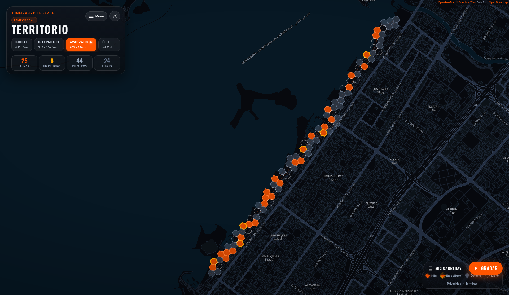
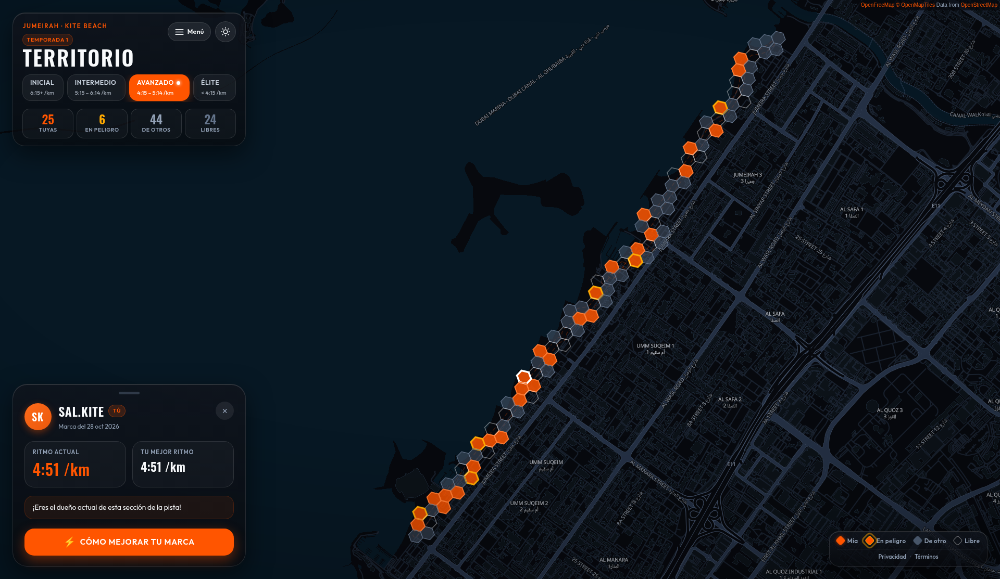
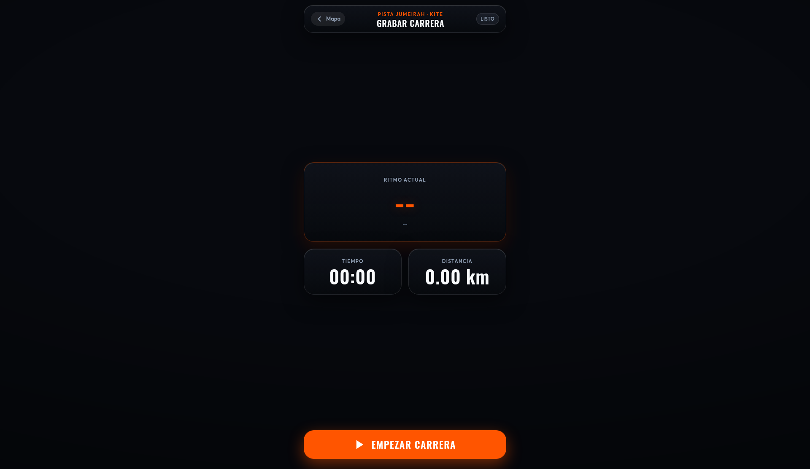
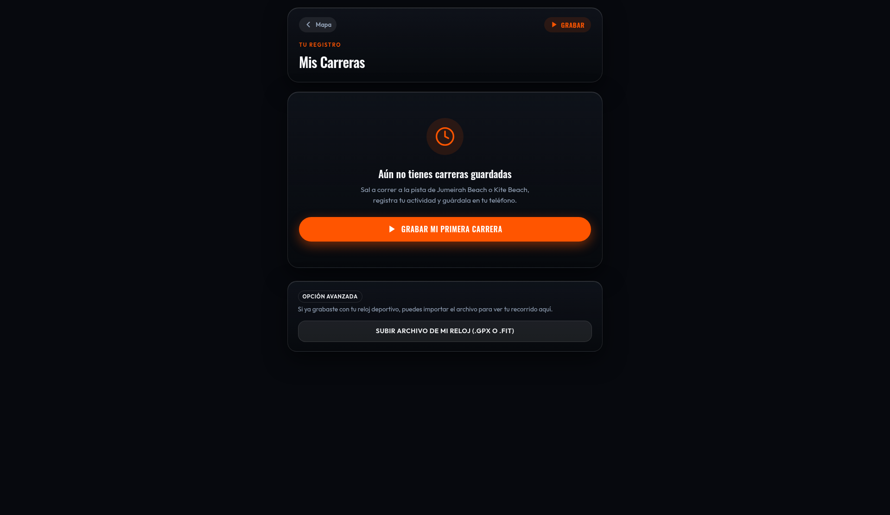
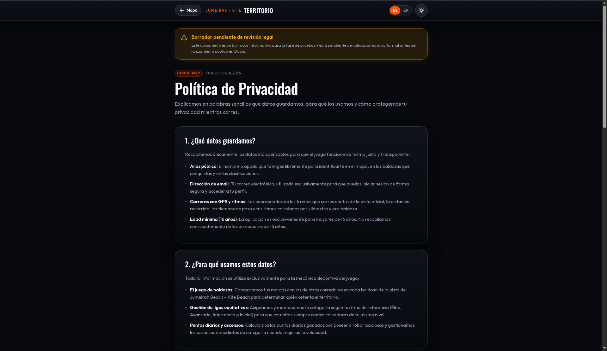
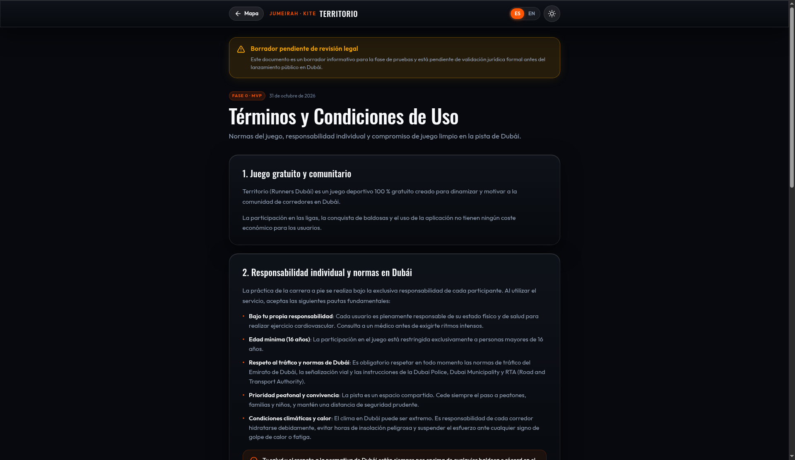

# Dubai Run Territory

PWA para corredores de Dubái: conquista territorio hexagonal por ritmo en la pista de Jumeirah–Kite Beach.

Cada carrera marca celdas del mapa. Las ligas se asignan por ritmo, así compites contra gente de tu nivel. El MVP ya está en vivo como web/PWA.

**App en vivo:** [https://dubai-run-territory.vercel.app](https://dubai-run-territory.vercel.app)



Al pulsar una baldosa se abre de quién es y las marcas de ritmo. Esta es una baldosa propia, sin nombre: la etiqueta dice «Tú», se muestra el alias público y la ficha enseña la fecha de la marca, el ritmo actual (4:51 /km) y tu mejor ritmo en esa sección (4:51 /km).



Pantallas reales de la app en el arranque. Grabar aún no ha empezado y Mis carreras no tiene registros: en estas capturas no hay datos de usuario.

<p>
  
  
</p>

Grabar está en **listo** (tiempo 00:00, distancia 0,00 km, ritmo sin dato). Mis carreras muestra «Aún no tienes carreras guardadas».

<p>
  
  
</p>

Privacidad y términos, con el aviso de borrador pendiente de revisión legal.

## Estado actual

MVP web/PWA en validación sobre la zona Jumeirah Beach → Kite Beach. Repo público. Sin métricas de usuarios publicadas todavía: el foco ahora es probar en la pista real.

| Área                               | Estado        |
| ---------------------------------- | ------------- |
| Mapa de territorios (99 celdas H3) | En producción |
| Ligas por ritmo                    | En producción |
| Grabar carrera con GPS (`/grabar`) | En producción |
| Mis carreras + detalle móvil       | En producción |
| Español / English                  | En producción |

## Qué hace hoy

- **Territorio hexagonal:** la pista se parte en celdas; la conquista va por el mejor ritmo en una ventana de 1 km.
- **Ligas por ritmo:** cuatro ligas; la primera carrera te sitúa y puedes ascender.
- **Grabación GPS en la app:** seguimiento en el teléfono, ritmo y velocidad estables, aviso de no bloquear el teléfono.
- **Mis carreras:** lista local, resumen, mini mapa del recorrido y borrado seguro (ajustado para iPhone Safari).
- **Español / English:** disponible en la app, con selector y detección automática.
- **Páginas legales:** `/privacidad` y `/terminos` (borrador pendiente de revisión legal).

## Stack

- **Frontend:** Next.js (export estático), PWA, MapLibre GL, OpenFreeMap
- **Dominio:** TypeScript monorepo (`apps/web`, `packages/core`), H3 res 10, parsers GPX/FIT
- **Backend previsto:** Supabase Free (Postgres + RLS + Edge Functions)
- **Hosting de validación:** Vercel Hobby → portable a Cloudflare Pages cuando haya ingresos
- **Costo de fase 0:** pensado para quedarse en cero (sin APIs de mapas de pago)

## Cómo correrlo

Hace falta Node 22 y pnpm 10.

```bash
pnpm install
pnpm dev
```

Abre [http://localhost:3000](http://localhost:3000).

```bash
pnpm lint
pnpm typecheck
pnpm test
pnpm build
```

`pnpm build` deja el sitio en `apps/web/out`. Para ver esa carpeta:

```bash
python3 -m http.server 3000 --directory apps/web/out
```

`pnpm zone:cells` regenera el polígono y las 99 celdas H3 de la zona a partir del eje de la pista. `pnpm seed:sql` escribe la migración idempotente que inserta esa zona, las cuatro ligas y la temporada 1.

## Estructura

```
apps/web/                 PWA (Next.js, mapa, textos)
packages/core/            Zonas, celdas H3, ligas, parsers y antitrampas. Sin DOM
supabase/migrations/      Esquema, RLS y seed de Jumeirah · Kite
supabase/seed/zones/      GeoJSON de la zona y la lista de celdas
scripts/                  Regenera la zona, el seed SQL y la verificación de DB
docs/                     PRODUCTO, ARQUITECTURA, TAREAS, ESTADO, DEPLOY
```

Marina, Al Qudra y Downtown ya están en el catálogo de `packages/core`, en borrador y sin polígono. Añadir una zona es meter su geometría en ese catálogo y volver a cortar las celdas.

## Mapa y celdas

- Teselas de [OpenFreeMap](https://openfreemap.org/) (estilo oscuro retocado, sin API key). MapLibre pone la atribución.
- Resolución H3 **10**: lado medio unos 66 m y área unos 15.000 m². Una celda se cruza en medio minuto a ritmo de club, así que la ventana de 1 km de las reglas mide una carrera de verdad y no un sprint de GPS. La 9 se come playa y carretera; la 11 parpadea con el error del reloj.
- El eje sale de OpenStreetMap (way 332925290, Jumeirah Corniche Running Track), unos 6,85 km. El polígono es un pasillo de 25 m a cada lado. **Son coordenadas aproximadas.** Hay que validarlas con una carrera real.

## Variables

Copia `.env.example` a `apps/web/.env.local` cuando haya anon key. Sin esa clave la app abre igual: el mapa puede usar datos locales de demostración.

No guardes service role keys ni secretos en el repo. Las variables públicas van documentadas en [`docs/DEPLOY.md`](docs/DEPLOY.md). El nombre y el ref del proyecto de validación están en `.env.example`.

## Base de datos

Las migraciones están en `supabase/migrations/`. Para aplicarlas al proyecto real, con el CLI de Supabase y sin guardar claves en el repo:

```bash
supabase link --project-ref <tu-project-ref>
supabase db push
```

Eso crea el esquema, el RLS y el seed de Jumeirah · Kite (zona en borrador, 99 celdas, 4 ligas, temporada 1 en `scheduled`). Los pasos y el contrato `CellEffort` están en [`docs/ARQUITECTURA.md`](docs/ARQUITECTURA.md) §4.

`pnpm db:verify` comprueba las migraciones contra un Postgres local. No usa el proyecto hospedado.

## Roadmap breve

1. Seguir validando en la pista de Jumeirah–Kite con carreras reales.
2. Login y sincronización remota de carreras.
3. Desplegar `process-run` y conectar conquista real en Supabase.
4. Conexión Garmin / Polar (Strava fuera de fase 0).
5. Más zonas de Dubái (y más adelante Caracas / Lechería) cuando el MVP se valide con corredores reales.

El backlog detallado está en [`docs/TAREAS.md`](docs/TAREAS.md). El estado por tarea está en [`docs/ESTADO.md`](docs/ESTADO.md). Las reglas del producto están en [`docs/PRODUCTO.md`](docs/PRODUCTO.md).

## Privacidad y legal

- Páginas `/privacidad` y `/terminos` en la app (borrador pendiente de revisión legal).
- La grabación GPS vive primero en el teléfono; no se publican horarios ni puntos de inicio/fin de rutas personales.
- Edad mínima prevista: 16 años.
- Contacto de privacidad: pendiente de un correo real del proyecto (hoy aparece un placeholder en la app).

## Contribuir

Lee [`AGENTS.md`](AGENTS.md) antes de abrir un PR. Una tarea = una rama = un PR. Actualiza `docs/ESTADO.md` en el mismo cambio. No trabajes directo en `main`.
